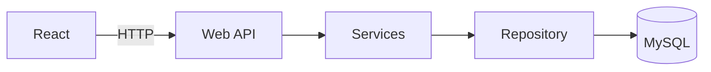

<div align="center">

# RetroGames

**Catálogo web e administração de jogos retrô usados**


[Sobre](#sobre-o-projeto) • [Funcionalidades](#funcionalidades) • [Arquitetura](#arquitetura) • [Execução](#como-executar) • [Testes](#testes)

</div>

## Sobre o projeto

O RetroGames é uma aplicação web full stack desenvolvida como projeto acadêmico de desenvolvimento web. Seu objetivo é disponibilizar um catálogo de jogos retrô usados e permitir a manutenção dos produtos e plataformas por administradores.

O projeto aplica conceitos de APIs REST, programação em camadas, bancos de dados relacionais, autenticação, validação de dados e integração entre frontend e backend.

## Funcionalidades

### Catálogo público

- Listagem de jogos com busca textual, filtros por plataforma e gênero e paginação.
- Página de detalhes de cada jogo.
- Consulta de plataformas, gêneros e condições dos jogos.

### Administração e autenticação

Recursos implementados na API:

- Cadastro, alteração e exclusão lógica de jogos e plataformas.
- Associação de jogos a gêneros.
- Login, logout e consulta do usuário autenticado.
- Controle de acesso às operações administrativas.

O frontend atende ao catálogo público e possui infraestrutura de autenticação. A interface administrativa ainda está em desenvolvimento.

## Tecnologias

| Backend | Frontend |
| --- | --- |
| C# e .NET 10 | JavaScript e React 19 |
| ASP.NET Core Web API | Vite 8 |
| ADO.NET e MySqlConnector | Bootstrap 5 |
| MySQL 8 | React Router e Axios |
| FluentValidation | Oxlint |
| xUnit e Moq | |

A documentação interativa da API utiliza OpenAPI e Swagger UI.

## Arquitetura

A aplicação é organizada em camadas, separando a interface, as regras de negócio e a persistência dos dados.



| Diretório | Responsabilidade |
| --- | --- |
| [RetroGames.Model](RetroGames.Model) | Entidades do domínio |
| [RetroGames.Repository](RetroGames.Repository) | Acesso ao banco e SQL parametrizado |
| [RetroGames.Services](RetroGames.Services) | Regras de negócio e composição de dados |
| [RetroGames.WebApi](RetroGames.WebApi) | Controllers, autenticação e validação |
| [RetroGames.WebApi.ApiModels](RetroGames.WebApi.ApiModels) | Contratos de entrada e saída da API |
| [RetroGames.WebApi.UnitTests](RetroGames.WebApi.UnitTests) | Testes unitários |
| [retrogames.web](retrogames.web) | Interface web |
| [database](database) | Scripts SQL e consultas |

Entre as práticas adotadas estão injeção de dependências, tratamento centralizado de exceções, autenticação por cookies, armazenamento de senhas como hash e separação das configurações sensíveis do código-fonte.

## Como executar

### Pré-requisitos

- .NET SDK 10
- Node.js 22.12+ (ou versão compatível com Vite 8) e npm
- MySQL 8
- Git

### 1. Clonar o repositório

```bash
git clone https://github.com/allanvictor-dev/Retro-Games.git
cd Retro-Games
```

### 2. Configurar o banco de dados

Com o MySQL em execução, crie o banco e utilize uma conta local com permissões sobre ele:

```sql
CREATE DATABASE retrogames CHARACTER SET utf8mb4;
```

Execute os scripts da pasta [database/scripts](database/scripts) em ordem numérica, de 001 a 015. Em Bash, a partir da raiz do projeto:

```bash
for arquivo in database/scripts/*.sql; do
    mysql -u SEU_USUARIO -p retrogames < "$arquivo" || break
done
```

Substitua SEU_USUARIO pelo usuário local do MySQL. Os scripts criam as tabelas e inserem os dados iniciais; execute-os em um banco novo.

### 3. Configurar as variáveis de ambiente

```bash
cp .env.example .env
```

Edite o arquivo .env na raiz e configure:

| Variável | Descrição |
| --- | --- |
| `ConnectionStrings__Default` | String de conexão com o MySQL |
| `AdminInicial__Email` | E-mail do administrador inicial |
| `AdminInicial__Senha` | Senha do administrador inicial |

A API cria o administrador inicial durante a inicialização, quando necessário. O arquivo .env não deve ser versionado.

### 4. Iniciar o backend

Na raiz do projeto:

```bash
dotnet restore
dotnet build
dotnet run --project RetroGames.WebApi
```

### 5. Iniciar o frontend

Em outro terminal, a partir da raiz:

```bash
cd retrogames.web
npm ci
npm run dev
```

| Serviço | Endereço local |
| --- | --- |
| Frontend | http://localhost:5173 |
| API | http://localhost:5080 |
| Swagger | http://localhost:5080/swagger |

Mantenha o MySQL e os dois servidores em execução.

## API REST

O cadastro de clientes, a finalização de compras, as consultas de pedidos e a gestão de situações e gêneros estão descritos na [especificação do Módulo de Compras](docs/modulo-compras.md).

Principais recursos disponíveis:

| Método | Endpoint | Descrição |
| --- | --- | --- |
| GET | /api/Jogo | Listar jogos |
| GET | /api/Jogo/{id} | Consultar detalhes |
| POST / PUT / DELETE | /api/Jogo (ou /{id}) | Manutenção de jogos |
| GET | /api/Plataforma | Listar plataformas |
| POST / PUT / DELETE | /api/Plataforma (ou /{id}) | Manutenção de plataformas |
| GET | /api/Genero | Listar gêneros |
| GET | /api/CondicaoJogo | Listar condições |
| POST | /api/Autenticacao/login | Autenticar usuário |
| POST | /api/Autenticacao/logout | Encerrar sessão |
| GET | /api/Autenticacao/eu | Consultar sessão |

As operações de manutenção exigem autorização de administrador. Consulte o Swagger em ambiente de desenvolvimento para os parâmetros e corpos das requisições.

## Testes

Na raiz do repositório, execute os testes unitários do backend:

```bash
dotnet test
```

Para verificar o frontend:

```bash
cd retrogames.web
npm run lint
npm run build
```

## Status do projeto

Projeto acadêmico em desenvolvimento incremental, seguindo os roteiros e a especificação técnica do curso. As diretrizes de desenvolvimento estão disponíveis em [AGENTS.md](AGENTS.md).

---

Desenvolvido por [Allan Victor](https://github.com/allanvictor-dev).
